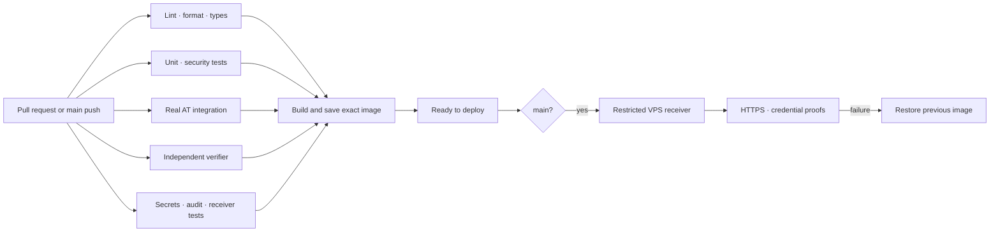

# Quality checks and deployment

The repository uses **Ultracite 8.0.1 with Oxlint 1.87.0, Oxfmt 0.71.0 and the matching type-aware Oxlint companion**. Versions, Node 24.17.0 and pnpm 11.8.0 are pinned. Frozen installs prevent a different dependency graph from silently reaching production. This follows the fast, explicit checks described in [Hayden Bleasel's article](https://haydenbleasel.com/writing/ultracite).

## Everyday workflow

```sh
pnpm install --frozen-lockfile
pnpm check
pnpm test:integration # affiliation / repository / permission changes
python3 -m unittest discover -s test -p '*_test.py' # deployment changes
```

`pnpm check` prints each stage and stops at the first failure. Use `pnpm fix` for Ultracite's safe fixes and formatting, review the diff, then rerun the checks. `pnpm format` only formats. Neither command commits code. Avoid blind `--unsafe` or suggestion fixes: passing style rules must not remove security checks or change workflow behaviour.

| Check                       | What a failure means                                                                                            | Fix locally                                                                                            |
| --------------------------- | --------------------------------------------------------------------------------------------------------------- | ------------------------------------------------------------------------------------------------------ |
| Lint, formatting and types  | An Oxlint rule, Oxfmt difference or TypeScript error                                                            | `pnpm lint`, `pnpm format:check`, `pnpm typecheck`                                                     |
| Unit and security tests     | A workflow or refusal path regressed                                                                            | `pnpm test`                                                                                            |
| AT Protocol integration     | Real repository signatures, exact CID consent, permissions or revocation failed                                 | `pnpm test:integration`                                                                                |
| Standalone verifier package | The consumer package cannot verify independently, its declarations fail, or issuer code leaked into it          | `pnpm test:package`                                                                                    |
| Secrets and dependencies    | Gitleaks found a secret, a production dependency has a moderate-or-higher advisory, or deployment checks failed | Rotate any exposed secret; update the dependency; run the Python receiver tests                        |
| Build release images        | The issuer or affiliation container cannot build from the frozen dependency graph                               | `docker build .` and `docker build -f deploy/pilot/Dockerfile .`                                       |
| Ready to deploy             | At least one required check failed, was cancelled or skipped                                                    | Open the named failed job; never bypass this gate                                                      |
| Deploy VPS demo             | Image receipt, container health or public proofs failed                                                         | Inspect the deployment log and VPS `release.json`; the receiver attempts to restore the previous image |

The root configs extend `ultracite/oxlint/core` and `ultracite/oxfmt`. Type-aware correctness rules apply to TypeScript. Browser/operator JavaScript still receives syntax/security linting. The verifier cannot import `src/`; package tests also check its distributed files. Inline comments document repository-specific exceptions: ordered remote writes, Node callbacks, tested runtime guards and existing schema validators. These are reviewed exceptions, not an unmodified stock preset. New workflow helpers retain the preset's complexity limit of 20. Do not weaken rules merely to pass a check.

Dependabot proposes weekly Action and npm updates, grouping the Oxc toolchain so its versions can be reviewed together. Every update goes through the same pipeline.

## CI/CD flow



Pull requests validate and build without deployment credentials. A successful `main` push automatically deploys the saved image from that same workflow run. All Actions are pinned by commit SHA. The `demo` GitHub environment is restricted to `main`; it holds the dedicated `DEMO_DEPLOY_KEY` and pinned `DEMO_KNOWN_HOSTS`. No root SSH key or application credentials enter GitHub.

**Repository-plan limit:** GitHub returned HTTP 403 for branch-protection configuration on this private repository. The workflow enforces all checks before deployment, but this plan cannot enforce checks before merging. If branch protection becomes available, require the `Ready to deploy` check, disallow force pushes and require review for workflow/deployment changes. No repository visibility or subscription was changed.

## VPS receiver and rollback

An operator installs `deploy/pilot/install-ci.sh PUBLIC_KEY_FILE` once on the VPS. This creates `affiliation-deploy`, a dedicated SSH account with a forced command, no forwarding, no PTY and no Docker group. The root-owned receiver accepts only `deploy REVISION SHA256` and an image archive on standard input. It validates argument formats, size bounds, SHA-256, archive paths and its single image tag, then checks the image's revision label.

The receiver serialises updates and changes only the affiliation Compose `app` service with `--no-deps --no-build`. It uses an immutable image ID in `/root/affiliation-pilot/.runtime/release-compose.json`. The bridges, gateway, other apps, keys and database volume are preserved. HTTPS health and currently valid public proofs are checked after replacement. A failed deployment attempts to recreate the previous image and checks it again; a failed rollback is a failed CI job requiring operator attention.

`/root/affiliation-pilot/release.json` records the successful revision, immutable image, archive digest and previous image. CI retains its image artifact for seven days; the VPS retains the previous local image. A manual rollback uses `write_override(previousImage)` from the installed receiver, then the same app-only Compose command and health check. Do not use `docker compose down -v`. Database schema migrations need a separate backup and compatibility plan; this release does not migrate the schema.

The receiver tests cover wrong arguments/digests/tags, traversal, size limits, successful release metadata and rollback without touching other services. The SSH deployment key can execute this application-image deployment only; it is still a sensitive deployment credential and must be rotated if exposed.
